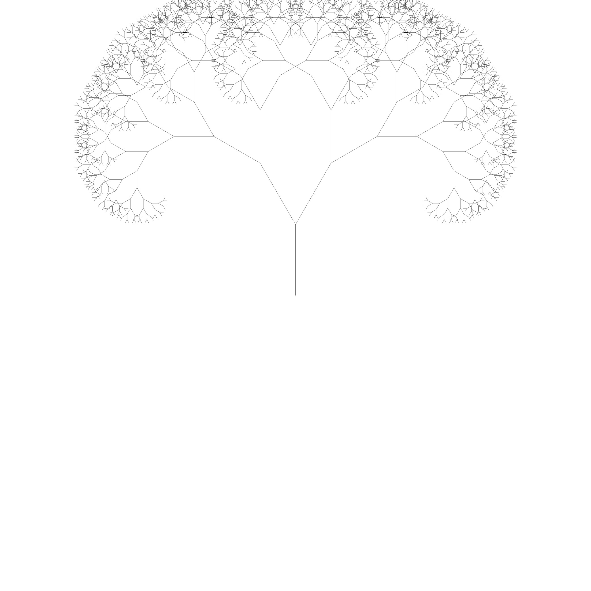
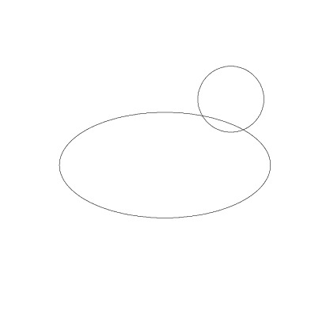

# Vector Graphics Library in C

A small C library that builds line drawings and saves them as EPS (Encapsulated PostScript) files. It plots functions, polylines, circles, ellipses and binary trees, and draws two fractals: a Koch snowflake and a fractal tree.

There is an article about the project, written in Turkish: [PostScript ve C](https://medium.com/@ahmedsemihozmekik/postscript-ve-c-320a00ec102a) on Medium.

<table>
<tr>
<td align="center"><br>Koch snowflake</td>
<td align="center"><br>Fractal tree</td>
<td align="center"><br>Asymmetric fractal tree</td>
<td align="center"><br>Circle and ellipse in one figure</td>
</tr>
<tr>
<td align="center"><br>Sine curve</td>
<td align="center"><br>Half circle</td>
<td align="center"><br>Circle</td>
<td align="center"><br>Circle, cropped</td>
</tr>
</table>

## API

Everything is declared in `epslib.h`.

| Function | What it does |
| --- | --- |
| `start_figure(width, height)` | Creates a figure whose canvas is centered on the origin. |
| `set_thickness_resolution(fig, resolution, thickness)` | Sets the sampling resolution for curves and the line width. |
| `set_color(fig, color)` | Sets the stroke color (RGB). |
| `draw_fx(fig, f, start_x, end_x)` | Plots y = f(x), sampled every 1/resolution. |
| `draw_polyline(fig, points, n)` | Joins n points with straight lines. |
| `draw_circle(fig, center, r)`, `draw_ellipse(fig, center, a, b)` | Plots the upper and lower halves with `draw_fx` and joins them. |
| `draw_binary_tree(fig, root, x, y)` | Draws a `Tree` as numbered circles connected by lines. |
| `draw_koch_snowflake(fig, center, size, num_iterations)` | Koch-style snowflake; 0 iterations gives the triangle. |
| `draw_fractal_tree(fig, x, y, size, num_iterations)`, `draw_fractal_atree(...)` | Symmetric and asymmetric fractal trees. |
| `scale_figure(fig, scale_x, scale_y)` | Scales the drawing around its center. |
| `resize_figure(fig, start_roi, end_roi)` | Sets the bounding box, which crops the output. |
| `append_figures(fig1, fig2)` | Adds fig2's drawing to fig1; fig1 keeps its color and line width. |
| `export_eps(fig, file_name)` | Writes the figure to an EPS file. |

## How it works

- A figure holds one linked list of `Point2D`. Each point is a line to that point, or a move if its `jump` flag is set. `export_eps` writes the bounding box, line width and color, then the list as `moveto`/`lineto` commands and a single `stroke`. Binary tree node numbers are set in Times-Roman.
- Each `draw_*` call replaces the figure's drawing. To combine shapes, draw them into separate figures and use `append_figures`.
- Koch snowflake: start from an equilateral triangle. The middle third of each edge is replaced by the two sides of a smaller equilateral triangle, and the same step repeats on those two new sides.
- Fractal tree: a trunk, then recursive branching where each branch splits into two branches 0.75 times its length. The symmetric tree turns 30 degrees each way; the asymmetric one turns 27 degrees one way and 57 the other.

## Building and running

```sh
make
./test_program
```

The makefile runs `gcc test_program.c epslib.c -lm -o test_program`. Build with GCC: `draw_circle` and `draw_ellipse` define nested functions, which standard C does not allow (see the warning in `epslib.h`).

`test_program` writes nine files to the current directory: `draw_fx.eps`, `polyline.eps`, `circle.eps`, `ellipse.eps`, `binary_tree.eps`, `append.eps`, `koch_snowflake.eps`, `fractal_tree.eps` and `fractal_atree.eps`.

## Layout

- `epslib.h`, `epslib.c`: the library
- `test_program.c`: calls each drawing function and exports the results
- `draw_fx.c`: a scratch driver, not built by the makefile
- `EPS/`: sample output; `JPEGS_EXAMPLE/`: JPEG renders of those files

## License

MIT, see LICENSE.
